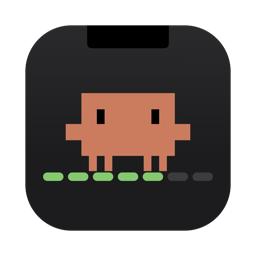
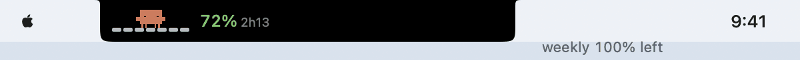
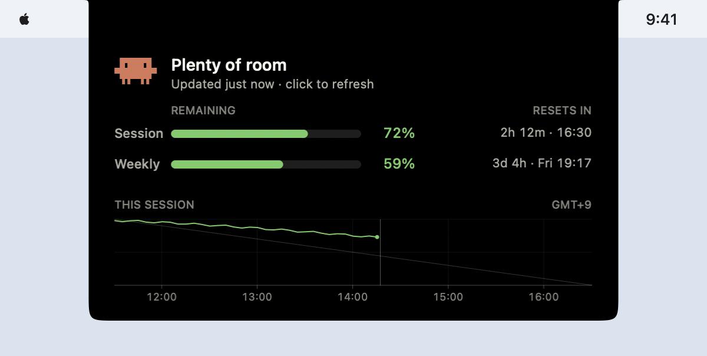

<p align="center"></p>

# Notchi Usage

A tiny, cute usage meter for Claude Code and Google Antigravity that lives in your MacBook notch. Native Rust + AppKit/Core Animation (objc2), no webview, ~500 KB binary, ~0% CPU at idle. Hover and it springs open like the Dynamic Island. Supports multi-provider tracking with dynamic notch expansion. Requires macOS 14+.

<p align="center"></p>

<p align="center"></p>

## What it shows

- **Multi-provider tracking** — monitor Claude Code, Google Antigravity, or both side-by-side.
- **Dynamic notch expansion** — the notch smoothly expands its ear width to accommodate multiple active providers.
- **Collapsed** — Clawd and the Antigravity arch logo standing on 7-day weekly bars that drain as you use your weekly budget (when short, characters panic and teeter on the edge), followed by session remaining and reset time. Try `--demo` (sweeps the week from 100% to 0% every 40 s) or `--preview-week=15`.
- **Hover** — expands to show every limit (Session, Weekly, plus Opus/Sonnet weekly for Claude; Session 5-Hour and Weekly for Antigravity) with remaining-bars, percentage left, and time until reset.
- **Menu toggling** — right-click (or ctrl-click) context menu lets you toggle Claude Code and Google Antigravity visibility at runtime with persistent settings.
- **Session graph** — a hairline graph of session % left across the current 5-hour window, with an even-pace guide (built from Notchi's own polls, so it fills in while it runs).
- **Click** to refresh now. **Right-click** for Refresh Now / Open Usage Page / Provider Toggles / Launch at Login / Quit.
- Character mood follows whichever limit is tightest: happy → busy → sweating → dizzy. Characters blink and emote dynamically.

## Data & token cost

- **Claude Code**: Notchi reads the OAuth token that Claude Code stores in the macOS Keychain (`Claude Code-credentials`) and calls `https://api.anthropic.com/api/oauth/usage`. That endpoint is not a model call, so it costs **zero tokens**. The token is only read, never refreshed, so your Claude Code session is untouched. The first launch shows a Keychain prompt — choose "Always Allow". If the token expires, just open Claude Code once and it refreshes. **Claude desktop app only?** If there is no usable Claude Code login, Notchi falls back to the desktop app's sign-in: it decrypts the token in `~/Library/Application Support/Claude/config.json` with the "Claude Safe Storage" Keychain key (read-only; the app refreshes its own tokens) and uses it for the same usage call. The token is passed to curl via stdin, so it never shows up in `ps`.
- **Google Antigravity**: Notchi reads usage information via the Antigravity CLI (`agy -p "/usage" --output-format json`) or local quota cache (`~/.gemini/antigravity-cli/antigravity-usage.json`) to track Gemini quota in real-time.

## Install

Download `NotchiUsage.zip` from the [latest release](https://github.com/jeanboy44/claude-code-usage-notch/releases/latest), unzip, and move `NotchiUsage.app` to `/Applications`. It's ad-hoc signed (not notarized), so the first time either right-click → Open, or run:

```sh
xattr -dr com.apple.quarantine /Applications/NotchiUsage.app
```

Apple Silicon, macOS 14+. To start it automatically, right-click the notch → **Launch at Login** (or run `/Applications/NotchiUsage.app/Contents/MacOS/notchi-usage --launch-at-login=on`).

## Permissions

| What you'll see | Why | What to do |
|---|---|---|
| "NotchiUsage can't be opened / unidentified developer" | The app is ad-hoc signed, not notarized by Apple | Right-click → Open once, or `xattr -dr com.apple.quarantine /Applications/NotchiUsage.app` |
| "NotchiUsage wants to use your confidential information stored in 'Claude Code-credentials'" | Notchi reads Claude Code's login token (read-only) straight from the Keychain | Enter your Mac password and choose **Always Allow**. The grant is for NotchiUsage only; it may ask once more after an update because the app is ad-hoc signed |
| "NotchiUsage wants to use your confidential information stored in 'Claude Safe Storage'" (only when Claude Code has no valid login) | Notchi reads the Claude desktop app's login token (read-only) to show your usage | Enter your Mac password and choose **Always Allow**. Like the row above, the grant applies to NotchiUsage only, not to other programs |

That's all. No Accessibility, Screen Recording, Full Disk Access or other permissions are needed. To revoke access later, open Keychain Access → `Claude Code-credentials` → Access Control and remove `NotchiUsage`. Same for `Claude Safe Storage`.

## Build from source

```sh
cargo build --release && ./target/release/notchi-usage   # run directly
./bundle.sh --install                                    # /Applications/NotchiUsage.app
```

## Config (optional)

`~/.config/notchi-usage/config`

```ini
refresh_secs = 120                           # poll interval, min 30; backs off automatically on 429
keychain_service = Claude Code-credentials   # point at another account/profile's Keychain item
show_claude = true                           # toggle Claude Code provider visibility
show_antigravity = true                      # toggle Google Antigravity provider visibility
```

Multiple accounts: by default the account behind the default Keychain item is shown. Recent Claude Code versions store a separate item per `CLAUDE_CONFIG_DIR` (named like `Claude Code-credentials-<hash>`); find yours with `security dump-keychain | grep "Claude Code-credentials"` and set `keychain_service` to show that profile instead.

## Behaviour notes

- Hover must linger ~0.12 s before the panel opens, so sweeping toward menu-bar items doesn't trigger it. It never takes keyboard focus.
- Clicks are coalesced (at most one fetch per 15 s) and never bypass a 429 backoff. On 429 it waits at least 5 min (or the server's `Retry-After`, if longer) and doubles on repeats.
- The last numbers and the next allowed poll time are cached in `~/Library/Caches/notchi-usage/state.json`, so restarting shows data instantly and never polls early or re-trips a rate limit.
- Each poll logs one line to stderr (status only, never the token).
- An expired token is detected from `expiresAt` locally, so no request is sent until Claude Code renews it.
- Numbers dim when they're stale (error or > 10 min old) and the status line shows their age. When a window's reset time passes it shows as full, and a fetch is scheduled right after each reset. After wake from sleep it refreshes within a few seconds; offline retries every 15 s.
- Respects Reduce Motion; VoiceOver reads a full summary and "press" refreshes.

## Releasing

```sh
scripts/release.sh 0.1.3 "What changed"
```

Builds, signs, zips and publishes a GitHub release. With a Developer ID configured (`DEVELOPER_ID` + a `notarytool` keychain profile — see the header of `scripts/release.sh`) it also notarizes and staples, so users get no Gatekeeper warning.

## README media

The images above are drawn by the app itself (no screenshots), so they always match the code:

```sh
./target/release/notchi-usage --render-readme /tmp/notchi-readme
python3 scripts/make_gifs.py /tmp/notchi-readme docs   # needs Pillow
scripts/make_icon.sh                                    # app icon → assets/AppIcon.icns, docs/icon.png
```

## Design

See [DESIGN.md](DESIGN.md). All tokens live in `src/theme.rs`.

---

Unofficial fan project, not affiliated with or endorsed by Anthropic or Google. Claude, Claude Code and Clawd are Anthropic's. Antigravity is Google's.
